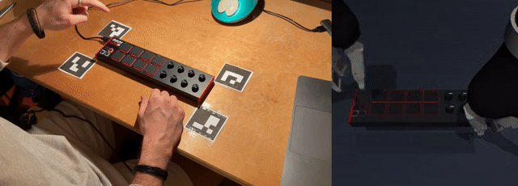
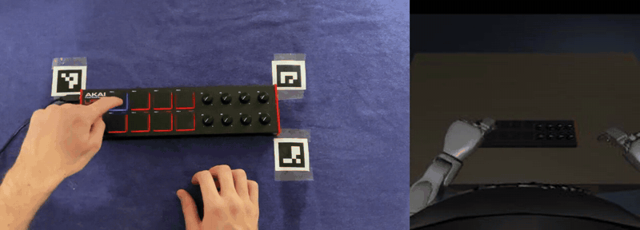
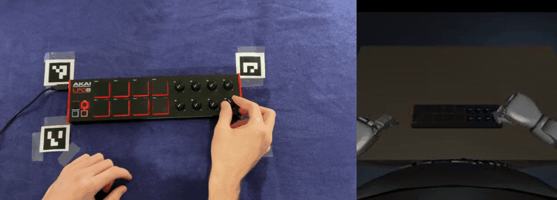

# Kraftwerk Bot: a humanoid robot that plays along to music

Dylan Winters · Humanoid Robot Learning Internship

## Demo

https://github.com/user-attachments/assets/50867109-e994-411a-a6ed-10f99850fd18

https://github.com/user-attachments/assets/76d17af8-ead6-4789-bcae-7bb45757b394

*Left: me playing a take. Right: the trained model playing the same music in simulation, on its own. Neither take was used in training.*

A simulated Unitree G1 stands at an Akai LPD8 controller. It hears a drum loop with one percussion part missing and plays that part:

| Part | Control | What it plays |
|---|---|---|
| Claps | Pad 1 | Beats 2 and 4 |
| Rims | Pad 5 | A syncopated pattern, four hits a bar |
| Shakers | Knob 4 | Fades the shaker part in and out |

The instruction is always *“Play along with this beat.”* The robot has to work out **which part to play from what is missing in the music, and when to play from the beat**.

I recorded 160 takes of myself playing, converted the videos into robot demonstrations, and fine-tuned OpenVLA-OFT, a vision-language-action model that I extended to hear music. I then trained a much smaller model to copy the rims policy.

## Results

Held-out takes at the trained tempo of 65 BPM. Each take is played five times, with different delays before the music starts:

| Part | Model | Right part played | Performance when the part is right |
|---|---|---|---|
| Claps | Three-part | 23 / 35 | 92% of beats hit, 51 ms average timing error |
| Rims | Three-part | 2 / 40 | — |
| Rims | Rims-only | 33 / 40 | 98% of beats hit, 37 ms |
| Rims | Distilled student | **40 / 40** | 99.7% of beats hit, 34 ms |
| Shakers | Three-part | 24 / 30 | Volume error 0.27; my fades: 0.02 |

The three-part model could play claps and shakers, but rarely chose rims. Further training on rims alone improved its performance, and the smaller student improved it again. Choosing between the three-part and rims models is still manual.

[Full results, including muted music, unseen chords and tempo changes →](runs/README.md)

## Background

I'd been meaning to start a project teaching a robot to play music, and this internship seemed like a good opportunity. I wanted to see whether a robot could use music as a cue for what to do and when, the way a band member does.

The missing-part task gives the audio two jobs. The rhythm tells the robot when to move, while the combination of instruments tells it what to play. Keeping the instruction the same means it can't simply be told which part is missing.

The robot only hears the backing track. Its own playing is never added to the audio input, so it can't listen to its previous hits to keep time.

## Model choice

A **vision-language-action model**, or VLA, takes a camera image and a text instruction and predicts robot actions. I used **OpenVLA-OFT**, a 7B model that predicts a short sequence of movements at a time.

[Audio-VLA](https://arxiv.org/abs/2511.09958) adds sound to this kind of model. It listens to the robot's own contacts through gripper microphones, providing information about task progress that may not be visible. I adapted the approach to music coming from outside the robot.

> **Challenge.** The model needs to recognise rhythms and retain their timing. Compressing several beats into one summary of the audio could make that harder.
>
> **Solution.** I used **MERT**, an audio model pretrained on music, and kept its sequence of features rather than averaging them together. This gives the policy access to changes roughly every 13 ms.

Every 0.2 seconds, the policy receives the head-camera image, robot state, last four seconds of music and fixed instruction. It predicts a sequence of joint targets, executes the first part, then updates its prediction using the new observations.

I fine-tuned the model with LoRA adapters, keeping the original 7B weights frozen.

[Architecture and training details →](training/README.md)

## Version 1: claps on two Jaco arms

I started with a single claps part, recording 49 takes in one 30-minute sitting. Two cameras tracked my fingertip, and I converted those movements into demonstrations for two simulated Kinova Jaco arms.



*Left: my recording. Right: the Jaco replaying the demonstration made from it.*

On seven held-out takes, the trained model hit **99.8% of beats**, with **10.1 ms average timing error**, compared with 14.1 ms in my demonstrations.

> **Challenge.** The robot's state includes a clock. With the music always starting at the same time, it could learn a fixed schedule without listening.
>
> **Solution.** I added a random 0–2 seconds of silence before the music during training, then tested each take with five different delays.

Its first hit shifted with the music: adding two seconds of silence delayed the first hit by two seconds. With the music muted, it stayed still. This supported the idea that it was using the audio for timing.

The Jaco itself was less suitable. Its grippers were too slow for the motion, so the whole arm had to follow my fingertip at about six times its real speed, with additional special-case rules. I switched to a **G1 with Dex3 hands**, which could press the pads with an extended index finger within its speed and torque limits.

I then added rims and shakers.

## Version 2: three parts on a G1

### Recordings and dataset

The music is one song at 65 BPM, with a kick, six chord-loop variations, claps, rims and shakers. In each take, one percussion part is removed from the backing for the robot to play.

I recorded **160 takes: 49 claps, 63 rims and 48 shakers**. After conversion and simulation checks, 152 robot demonstrations were usable:

| Part | Train | Validation | Test |
|---|---:|---:|---:|
| Claps | 34 | 7 | 7 |
| Rims | 40 | 9 | 8 |
| Shakers | 34 | 7 | 6 |

My timing improved during the first recording session, so a chronological split would have trained on earlier, less precise takes and tested on later ones. I instead spread the splits across the recordings: in each block of seven takes, the fifth goes to validation and the seventh to test.

During training, each performance is paired with a random chord loop from 1–5. Half the test takes use chord loop 6, which never appears in training. This checks whether the model can still play when the backing changes.

[Recording setup, splits and file formats →](data/README.md)

### Converting videos into demonstrations

MediaPipe tracks my hand in both camera views, and the fingertip is triangulated in 3D relative to the controller. The robot's left index finger follows that path. For shakers, an overhead camera reads the knob angle, which the robot reproduces with its right hand.

> **Challenge.** The cameras captured the movement, but contact timing was less reliable. At 30 frames per second, a hit can fall anywhere within a 33 ms frame. Early demonstrations also brushed pads I hadn't played.
>
> **Solution.** I used the video for movement and the audio recording of my playing for contact times. Each hit is pinned to its pad at the recorded time, with the fingertip kept above the pads between hits.

The demonstrations are replayed in MuJoCo and checked for missed hits and extra touches. Compared with my recordings, the average timing difference was 19 ms for claps and 7 ms for rims; shaker volume error was 0.021.

| Rims | Shakers |
|---|---|
|  |  |

*Left of each clip: my recording. Right: the robot replaying it through the head-camera view used for training.*

[Video-to-robot pipeline →](pipeline/README.md)

## Training the three-part model

The model was trained on all three parts for 10,000 steps on one H200 GPU. Each sample comes from a random moment in a training take, with extra samples around the first movement, where the robot has to choose its part.

> **Challenge.** Early models could identify the part from the robot's movement. Shakers demonstrations immediately reached towards the knob, while the others reached towards the pads. Swapping the music barely changed the output.
>
> **Solution.** I made every demonstration start from the same pose and remain still for the first bar. The model then has to use the audio to choose its initial movement.

The resulting model played the correct part in 23 / 35 claps runs and 24 / 30 shakers runs, but only 2 / 40 rims runs. Shaker fades were also much less precise than the demonstrations.

### Why rims was difficult

On rims takes, the model usually played claps or turned the knob. A simple linear classifier on MERT's features identified the missing part correctly on every validation take, suggesting the audio representation contained the information needed.

The difficulty appeared to be in turning that information into the right action.

> **Challenge.** Pad 5 is only 3.3 cm behind pad 1. The initial movements for claps and rims differ by about as much as the model's ordinary prediction error, so choosing the wrong pad adds relatively little to the training loss. After the first hit, the robot's state also reveals which pattern it has started, allowing it to continue without listening.
>
> **Solution.** After naming the part in the instruction also failed to help, I fine-tuned the model on rims alone for another 2,500 steps.

This improved rims performance from **2 / 40 to 33 / 40**, with 98% of beats hit and 37 ms timing error when it played the right part.

The trade-off is that the rims-only model no longer needs to identify the missing part: it also plays rims when given claps music. I therefore use the three-part model for claps and shakers, and the rims-only model for rims.

## Policy distillation

The 7B model needs a large GPU to run. I trained a **1.8M-parameter student**, about 4,000 times smaller, to copy the rims model using the camera image, audio spectrogram and robot state.

Training starts with the teacher playing. Over four rounds, the student performs more of each take while the teacher provides action targets, including corrections for states reached through the student's own mistakes.

> **Challenge.** The teacher also makes mistakes. Many failed runs brush the knob, and copying those demonstrations could pass the same behaviour to the student.
>
> **Solution.** I kept only successful teacher runs for the first round. Later rounds retain all corrections so the student can learn to recover.

The student played rims in **40 / 40 test runs**, hitting 99.7% of beats with 34 ms average timing error. Its evaluation can also run on a CPU.

Filtering teacher failures may explain some of the improvement, but I didn't train an unfiltered student to check. It still failed at 82 BPM, as did every other model.

[Student architecture and distillation procedure →](training/README.md#distil)

## Limitations

- **Simulation only.** I haven't tested this on a physical robot.
- **One song and tempo.** All training is at 65 BPM. Performance drops at 67 BPM, and every model fails at 82 BPM.
- **Unreliable part selection.** Changing the backing chords can change the selected part. For claps, the three-part model scored 13 / 15 with trained chords and 10 / 20 with chord loop 6.
- **Separate rims model.** Choosing the appropriate model from the music isn't automated.
- **Imprecise shaker fades.** Volume error is 0.27, compared with about 0.02 for my demonstrations.
- **Small test set.** The reported runs repeat held-out recordings with different start delays; they aren't all independent performances.

## Replicate it

Download `data/` and `runs/` and put them at the repository root: **download link to be added**.

To watch a robot demonstration:

```bash
pip install -r requirements.txt
python -m robot_sim view --demo data/robot/rims_001
```

Training and teacher evaluation need Linux, a large NVIDIA GPU and about 50 GB of RAM; I used an H200. The viewer and video-to-robot pipeline don't need the training GPU.

| Folder | Details |
|---|---|
| [data/](data/README.md) | Recordings, music, splits and file formats |
| [pipeline/](pipeline/README.md) | Tracking and converting videos into demonstrations |
| [robot_sim/](robot_sim/README.md) | Simulation, robot controls and viewer |
| [training/](training/README.md) | Setup, architecture, training, evaluation and distillation commands |
| [runs/](runs/README.md) | Full results and evaluation notes |
