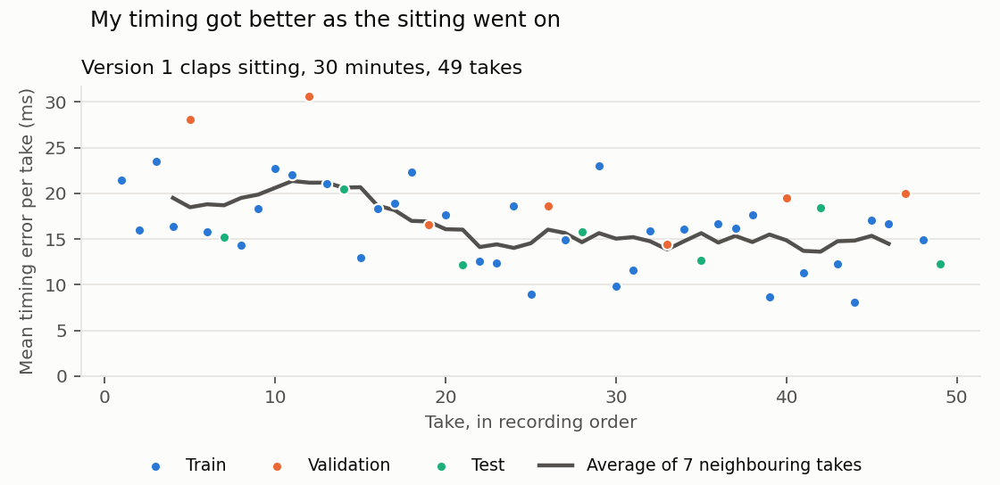

# Kraftwerk Bot: a humanoid robot that plays along to music

Dylan Winters · Humanoid Robot Learning Internship

## Demo

**[Claps](assets/demo_claps.mp4)** · **[Rims](assets/demo_rims.mp4)** (videos with sound)

Left: me playing a take. Right: the trained model playing the same music in simulation, on its own. Neither take was
used in training.

A simulated Unitree G1 humanoid stands at an Akai LPD8 pad controller. It hears a drum loop with one percussion part
missing, and plays that part:

| Part | Control | What it plays |
|---|---|---|
| Claps | pad 1 | beats 2 and 4 |
| Rims | pad 5 | a syncopated pattern, 4 hits a bar |
| Shakers | knob 4 | fades the shaker part in and out |

The text instruction stays the same throughout, *"Play along with this beat."* The robot has to work out **which** part to
play from what is missing in the music, and **when** to play from the beat.

**How it learned:** I recorded myself playing each part (160 takes, filmed from two angles), turned every video into a
robot demonstration by tracking my fingertip, and fine-tuned a 7-billion-parameter vision-language-action model
(OpenVLA-OFT) that I extended to hear music.

Results on held-out takes at the trained tempo, 65 BPM (each take played 5 times, after 0, 0.5, 1, 1.5 or 2 s of
silence; tempo changes and muted music are tested separately):

| Part | Model | Right part played | When right |
|---|---|---|---|
| Claps | three-part | 23 / 35 | 92% of beats hit, 51 ms average timing error |
| Rims | rims-only | 33 / 40 | 98% of beats hit, 37 ms |
| Rims | student distilled from rims-only | **40 / 40** | 99.7% of beats hit, 34 ms |
| Shakers | three-part | 24 / 30 | volume error 0.27 (my own fades: 0.02) |

## Replicate it

You need a Linux machine with one large NVIDIA GPU and about 50 GB of RAM for training and evaluation (I used an H200).
The simulation viewer and the video-to-robot pipeline run on any computer.

1. **Get the data and trained models.** `data/` and `runs/` are not in git because of their size: *(download link to
   be added)*. Put both folders at the root of the repo.
2. **Watch a robot demonstration** (any computer):
   ```bash
   pip install -r requirements.txt
   python -m robot_sim view --demo data/robot/rims_001
   ```
3. **Optional: rebuild the robot demonstrations from my videos** (any computer, a minute or two per take):
   ```bash
   python pipeline/camera_to_robot.py                  # data/human -> data/robot
   ```
4. **Set up the GPU machine** (a Python 3.10 environment with OpenVLA-OFT, in `~/venv-oft`):
   ```bash
   bash training/setup_oft.sh
   source ~/venv-oft/bin/activate
   export MUJOCO_GL=egl                                # simulation rendering without a screen
   ```
   On some cloud images MuJoCo also needs
   `export __EGL_VENDOR_LIBRARY_FILENAMES=/usr/share/glvnd/egl_vendor.d/10_nvidia.json`.
5. **Train** the three-part model, then the rims specialist from it:
   ```bash
   python training/audio_policy.py train --output runs/three_part
   python training/audio_policy.py train --output runs/rims_only --init runs/three_part --roles rims --steps 2500 --lr 1e-4 --eval-every 250
   ```
6. **Evaluate** in closed loop on the test takes. This writes `evaluation_test.json` and, with `--videos`, a video of
   each test take into the model's folder. To skip training, evaluate the downloaded models directly.
   ```bash
   python training/audio_policy.py evaluate runs/three_part --videos
   python training/audio_policy.py evaluate runs/rims_only --videos
   python training/audio_policy.py report "runs/*"     # summary table of every model
   ```
7. **Distil** the rims-only model into the small student, then evaluate it. The student's evaluation also runs on a
   CPU (`--device cpu`).
   ```bash
   python training/distill.py runs/rims_only --output runs/rims_student
   python training/audio_policy.py evaluate runs/rims_student
   ```

Training decodes every demonstration's camera frames into memory, hence the RAM. Evaluation runs 5 simulations in
parallel, each using about 20 GB of GPU memory.

## Background

I'd been meaning to start a project teaching a robot to play music, and this internship seemed like a good opportunity to do it.
Robots that use sound mostly listen for speech. I wanted to see whether a robot could use music as a cue for what to
do and when, the way a band member does. So the idea was to teach it to play along to a song.

> **Challenge.** A player in a band is never told when to come in or what to play; they work it out by listening. A robot normally gets
> both from its instruction or a fixed script.
>
> **Solution.** Use the music itself as the input, so it provides both pieces of information. The beat says *when*.
> And because the robot's own part is left out of the mix, *what* to play is the part it can't hear. The instruction
> stays the same every time, so the music is the only way to tell.

## Starting point: Audio-VLA

A **vision-language-action model (VLA)** takes a camera image and a text instruction and outputs robot actions. At its
core is a language model: the image is cut into patches, each patch becomes a *token* (like a word), and the model
reads image tokens and text tokens together.

**[Audio-VLA](https://arxiv.org/abs/2511.09958)** adds hearing. Microphones on the robot's gripper record the sounds
its own contacts make, a pretrained audio model turns the sound into features, and a small network projects those into
extra tokens placed next to the image tokens. The robot can then hear progress that the camera can't see.

I wanted to adapt this idea to music:

| | Audio-VLA | This project |
|---|---|---|
| What it hears | its own contacts, through gripper microphones | music from outside; the robot never hears its own pads |
| What the sound tells it | how the task is going | when to play (the beat) and which part to play (the missing one) |
| Tasks per model | one model per task | one model for three parts, chosen by the music |

> **Challenge.** The difficulty here is telling claps from rims by ear. In this song they share the same frequencies and
> differ only in rhythm, and the robot needs timing to the nearest few milliseconds. General-purpose audio encoders
> squash time into coarse chunks (AudioCLIP averages over about 0.2 s), which loses some of the timing information the robot needs.
>
> **Solution.** **MERT**, an audio model pretrained on music rather than general sound. It keeps a feature vector for
> every ~13 ms of audio, and all 299 of them go into the language model as separate tokens instead of one summary, so
> the model can attend to individual beats.

The base model is **OpenVLA-OFT**: OpenVLA (a Llama 2 7B language model with two image encoders) fine-tuned with the OFT
recipe, which predicts a chunk of 25 future actions in one pass through a small regression head instead of one token
at a time. I fine-tuned it with **LoRA**: small trainable adapters inside every layer, while the original 7B weights stay
frozen.

## Architecture


- **Inputs, every 0.2 s:** the head-camera image (224 x 224 px); the robot state (95 numbers: 28 joint positions and
  velocities, a clock, the last 4 pads hit, the number of hits, the knob angle); the last 4 s of music; the fixed
  instruction.
- **Music** goes through **MERT-v1-95M**, an audio model pretrained on music (frozen), giving 299 feature vectors, one
  per ~13 ms. A 3-layer projector (from Audio-VLA) turns them into 299 tokens.
- **Robot state** becomes 1 token through OFT's 2-layer projector. The **image** becomes 256 tokens through OpenVLA's
  own vision encoders.
- **Token sequence:** vision, state, audio, instruction, then 375 empty action slots (25 time steps x 15 joint targets).
  The language model fills all 375 in one pass.
- **Output:** 25 steps of 15 targets (14 arm joints and the right hand's grip), expanded to the robot's 28 joints
  and sent to MuJoCo position controllers at 60 Hz. The robot plays the first 12 steps, then predicts again.
- **Trained:** the LoRA adapters, both projectors and the action head. **Frozen:** MERT and the 7B base weights.

## Version 1: claps on two Jaco arms

To see whether the idea would work, I first recorded one 30-minute sitting of a single part: a backbeat (pad 1 on beats 2 and 4, 65 BPM)
played along to music. Two cameras filmed my hand while the music software recorded what I played. That gave 49 takes
of about 6 bars, converted into demonstrations for a simulated dual-arm Kinova Jaco with the tracking method described
below.


*Left: me playing a take. Right: the simulated Jaco replaying the demonstration made from that video.*

### A dataset that changes while you record it



> **Challenge.** I got a bit better as the sitting went on: my average timing error per take fell from about 20 ms in the
> first 20 takes to about 15 ms in the last 29. A standard chronological 70 / 15 / 15 split would train on my early,
> looser takes and test on my later, tighter ones, so the test would partly measure my improvement, not the model.
>
> **Solution.** I interleaved the split. In every block of 7 consecutive takes, the 5th goes to validation and the 7th to
> test, so all three splits cover the whole sitting (the coloured dots above).

48 takes were usable: 34 train / 7 validation / 7 test. The G1 version uses the same split for every part.

### Results

On the 7 held-out takes:

| | Trained model | Reference |
|---|---|---|
| Beats hit | **99.8%** | my demonstrations: 100% |
| Timing error | **10.1 ms** | my demonstrations: 14.1 ms |
| Music starts later | the first hit moves with it exactly (slope 1.00) | 1 = follows the music, 0 = fixed clock |
| Music muted | **0 hits**: it waits | |
| Unseen tempo, 67 BPM | 100% hit, but 55 ms late | |
| Unseen tempo, 82 BPM | 17% hit | |

> **Challenge.** The concern here was whether the model was actually listening. The robot's state includes a clock, so a model that ignored the music could
> learn "first hit at 4.6 s" and still play perfectly on the training takes.
>
> **Solution.** I added a random 0 to 2 s of silence before the music, both in training and in testing. Every held-out take is
> played five times, after 0, 0.5, 1, 1.5 and 2 s of silence. A memorised clock would hit at the same moment every time.
> Instead, the first hit moved exactly with the music: 2 s more silence, first hit 2 s later, on every take (plot
> below). And with the music muted, it didn't play at all.


It was even slightly more precise than me, because it averages out my stroke-to-stroke jitter.

> **Challenge.** At this point the Jaco itself was the main limitation. A human taps with light, fast finger joints; the Jaco has slow
> grippers, so its whole arm had to trace my fingertip, simulated at about 6x its real speed and with many
> special-case rules.
>
> **Solution.** I switched to a body built more like mine: a **Unitree G1 humanoid with Dex3 hands**, pressing with an extended
> index finger in one fixed hand pose, at the G1's real speed and torque limits.

With a robot that could copy me properly, I wanted to make the task a bit harder, so I moved from one part to three.

## Version 2: three parts on a Unitree G1

### The music

- One song at 65 BPM in 13-bar cycles: a kick, a chord loop (6 variations), claps, rims and shakers.
- Each rims and shakers take is 11 bars: 2 bars where the other parts already play, 8 bars of playing, 1 bar after.
  The claps takes, from the version 1 sitting, are about 9 bars.
- The robot hears the kick, the chords and the two parts that aren't its own. Its own part is never in the mix.

> **Challenge.** My first G1 models ignored the music. The demonstrations started moving from the very first frame
> (towards the knob for shakers, towards the pads otherwise), so the robot's own motion gave its part away, and the
> model read it from there: swapping in another part's music barely changed its output.
>
> **Solution.** I held the robot still for the first bar of music. Every demonstration now starts from the same pose,
> so the first move, which commits to a part, can only come from listening.

### The dataset

- **160 takes:** 49 claps (the version 1 sitting), 63 rims (one ~50-minute sitting), 48 shakers (two sittings).
- **152 usable robot demonstrations** after the physics check below: claps 48, rims 57, shakers 47.
- **Split (train / validation / test):** claps 34 / 7 / 7, rims 40 / 9 / 8, shakers 34 / 7 / 6.

Each part was recorded in one long sitting, so it is split like version 1: in every block of 7 consecutive takes, the
5th goes to validation and the 7th to test. I made two more choices to keep the test fair:

- Half of the test takes use chord loop 6, which never appears in training.
- In training, each sample's backing uses a random one of chord loops 1 to 5. The same performance is heard over
  different chords, so the model can't tie its part to a particular chord loop; only the missing part tells it which
  part is its own.

### From my hand to the robot: tracking

`pipeline/camera_to_robot.py` turns each take into a robot demonstration:


*MediaPipe hand landmarks on both cameras. The orange ring is the index fingertip, which is triangulated in 3D and
followed by the robot.*

> **Challenge.** The cameras could track the motion, but working out when contact happened was more difficult. At 30 frames a second a hit can fall anywhere within a
> 33 ms frame, and tracking can't tell a fingertip hovering 5 mm above a pad from one touching it. Early demonstrations
> brushed pads I never played.
>
> **Solution.** I split the job between the two: **the cameras give the motion, the audio gives the contacts.** Hit times come from the
> recording of what I played, and the robot's fingertip is only allowed down onto a pad around those moments.

1. **Track:** MediaPipe finds my hand in both camera views; my index fingertip is triangulated in 3D in the
   controller's coordinates (the cameras are calibrated with ArUco markers).
2. **Time the hits:** from the audio of what I played. The pad is the one under the fingertip.
3. **Plan the robot:** the G1's left index fingertip follows my fingertip path. Each hit is pinned onto its pad at the
   right moment, and between hits the fingertip stays at least 8 mm above the pads. The arm's joint targets respect
   the G1's real speed and torque limits.
4. **Shakers:** an overhead camera reads the knob's angle while I turn it. The robot's right hand grips knob 4 and turns
   it through the same angle.
5. **Replay in physics (MuJoCo):** this records the robot's head-camera video, joint states and actions. A
   demonstration is kept only if the robot plays the same hits without extra touches.

Robot vs me: claps 19 ms average timing difference, rims 7 ms; shakers volume error 0.021.

| Rims | Shakers |
|---|---|
|  |  |

*Two training demonstrations. Left of each: me, filmed from above. Right: the robot replaying it, seen through its
head camera, which is the image the model learns from. Every demonstration has this video with sound in
`data/robot/<take>/compare.mp4`.*

## The three-part model: one model, three parts

The three-part model is trained on all three parts together: 10,000 steps, batch 16, on one H200 GPU. Each training sample is a
random moment of a random training take, preceded by 0 to 2 s of silence. 30% of the samples come from around the
robot's first move, which is where it has to decide its part. The best validation loss was 0.0104 (L1 on normalised
actions), against 0.040 for a robot that stands still.

Results on the test takes at 65 BPM (each played 5 times, with 0 to 2 s of silence first):

| Part | Right part | When right | Trained chords / chord 6 |
|---|---|---|---|
| Claps | 23 / 35 (66%) | 92% of beats hit, 51 ms | 13 / 15 · 10 / 20 |
| Rims | **2 / 40 (5%)** | | 0 / 20 · 2 / 20 |
| Shakers | 24 / 30 (80%) | volume error 0.27 (my fades: 0.02) | 13 / 15 · 11 / 15 |

With the music muted it stayed still in 16 of 21 takes. At 67 BPM it played the right part in 11 of 21 takes; at
82 BPM in none.

### What went wrong: rims

On rims takes the robot mostly played claps (25 of 40 runs) or turned the knob (9). It could hear the difference: a
simple linear classifier on MERT's features names the missing part correctly on every validation take. The problem
came down to what the model was rewarded for during training.

The model learns by copying my moves, and is scored by how far its predicted joint targets are from mine, moment by
moment. The issue becomes clearer at the point where it has to choose between claps and rims:

1. **Both start with the same movement.** Pad 5 is only 3.3 cm behind pad 1, so reaching for the wrong one is barely
   wrong at first. The first 25 actions of a claps take and a rims take differ by 0.010, the same size as the model's
   ordinary error everywhere else. Essentially, choosing the wrong pad costs about as much in training as a slightly shaky hand.
2. **By the time the paths split, the answer is given away.** The robot's state includes which pads it has already
   hit, so after the first hit the model can simply continue the pattern it started, without listening.

So the model was never really forced to get that initial decision right during training, and on rims takes it usually drifted to
claps.

> **Challenge.** The model has to make a decision that barely registers in its training loss. Making the decision more
> explicit didn't help either: naming the part in the instruction (*"Play the rims part..."*) still played rims 0 out
> of 40 times, because the instruction only matters where the moves differ, and they barely do.
>
> **Solution.** I removed the need for this model to choose between parts. The **rims-only** model is the three-part
> model fine-tuned for 2,500 more steps (learning rate 1e-4) on the 40 rims training takes alone. It keeps everything
> the three-part model learned about the robot, the controller and the beat, and only has to play one part.

### The fix: a rims specialist

After 2,500 extra steps, rims went from 2 to 33 out of 40:

| | three-part | rims-only |
|---|---|---|
| Rims, right part | 2 / 40 | **33 / 40** (trained chords 18 / 20, chord 6 15 / 20) |
| When right | | 98% of beats hit, 37 ms |
| Music muted | | stayed still 8 / 8 |
| 67 BPM / 82 BPM | 0 / 8 · 0 / 8 | 7 / 8 · 0 / 8 |

On its 40 training takes it scores 145 / 200 (72.5%), so its true rate is probably in the low-to-mid 70s; the 8 test
takes happen to be on the easier side. Most remaining misses touch the knob, a habit inherited from the three-part
model.


*The rims-only model playing a held-out test take on its own, seen through its 224 px head camera: everything it
sees.*

It is still a specialist though: on claps music it plays rims too. So the three-part model plays claps and shakers, and rims-only
plays rims.

## Distillation: a small, fast student

The 7B model needs a large GPU to predict every 0.2 s, which makes it expensive to run and to improve further with
reinforcement learning. Distillation trains a much smaller model, the *student*, to copy it.

- **Student (1.8M parameters, about 4,000x smaller):** a small CNN on a 112 px camera image, a 1-D CNN on a
  spectrogram of the last 4 s of music, and a small network on the robot state. It outputs the same 25-step chunk.
- **Teacher:** the rims-only model, on rims training takes.
- **DAgger, 4 rounds of 64 takes:** in round 0 the teacher plays; in later rounds the student plays more and more of
  each take (50%, 75%, 88%), and the teacher labels every moment, so the student also learns to recover from its own
  mistakes.
> **Challenge.** The issue is that the student also copies its teacher's mistakes. On the training takes the teacher
> plays the right part only about 70% of the time, and most of its misses brush the knob.
>
> **Solution.** I limited the initial training to the teacher's successful takes. In round 0 the teacher played the right part in 45 of 64
> takes, and the student learns from those 45 only. Later rounds keep every correction, because those teach the
> student to recover.

The student beat its teacher on the rims test takes:

| Rims test takes | Teacher (rims-only, 7B) | Student (1.8M) |
|---|---|---|
| Right part, 65 BPM | 33 / 40 | **40 / 40** |
| When right | 98% of beats hit, 37 ms | 99.7% of beats hit, 34 ms |
| 67 BPM / 82 BPM | 7 / 8 · 0 / 8 | 8 / 8 · 0 / 8 |
| Music muted | stayed still 8 / 8 | stayed still 8 / 8 |

The same held during training: in the last round, with the student doing about 88% of the playing, the robot played
the right part in 61 of 64 training takes (95%), against the teacher's 45 of 64 alone. The likely reason is the
filtering: the knob brushes behind most of the teacher's misses were never shown to the student. (I didn't train an
unfiltered student to confirm it.) It still can't handle 82 BPM: like every model here, it has only ever heard 65.

## Limitations

- **Simulation only.**
- **One tempo.** All training is at 65 BPM. At 67 BPM results drop (three-part model: 11 / 21); at 82 BPM every model
  fails.
- **The part choice is fragile.** A different chord backing can flip it (three-part model on claps: 13 / 15 with
  trained chords, 10 / 20 with chord 6).
- **Two models.** Rims needs its own model, and picking the right model from the music isn't automated in this repo.
- **Shaker fades** are much less precise than mine (volume error 0.27 vs 0.02).

## Repository

```
data/human/<take>/   my recording: human.mp4 (+ human_cam2.mp4), played.wav (my part), music.wav (what the
                     robot hears), episode.json (metadata, hit times, camera calibration); shakers: knob_target.npz
data/robot/<take>/   the robot demonstration: robot.mp4 (head camera, lossless), robot.npz (joint states, actions,
                     knob angles), robot.json (hits, checks), compare.mp4 (me | robot)
data/music/          the loops; the chord variations are mixed from them during training
data/jaco_v1/        the version 1 Jaco demonstrations
pipeline/            camera_to_robot.py: data/human -> data/robot
robot_sim/           the MuJoCo simulation (G1, and the version 1 Jaco), planning, replay, viewer
training/            audio_policy.py (train, evaluate, report), distill.py (the student), setup_oft.sh (GPU setup)
configs/             controller geometry and robot settings
runs/                three_part and rims_only (weights, training curves, evaluations, videos), rims_student (the
                     distilled student), jaco_v1 (results)
assets/              README figures and videos
```

See [Replicate it](#replicate-it) for the commands.
