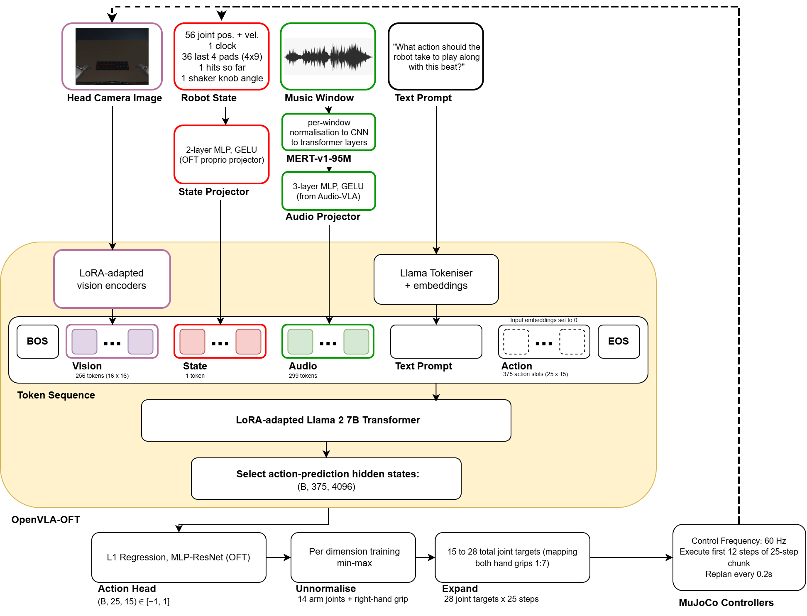
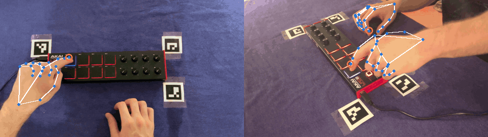

# Kraftwerk Bot: a humanoid robot that plays along to music

This is my (Dylan Winters) submission for Humanoid's Robot Learning Research internship challenge.

I taught a simulated Unitree G1 humanoid to play along to music. It hears a drum loop with one percussion part missing and plays that part on a pad controller. I trained a three-part model, which is a 7B vision-language-action model that I fine-tuned on recordings of myself playing each part. It rarely chose rims correctly, so I fine-tuned a copy on rims alone, which I call the rims-only model. I then distilled the rims-only model into a student about 4,000 times smaller that can run on a CPU. This README outlines the results, core implementation decisions, challenges and limitations involved.

## Demo (to be viewed with sound on)

*Left: me playing a take. Right: the trained model playing the same music in simulation, on its own. Neither take was used in training.*

https://github.com/user-attachments/assets/639d0e7d-4017-4743-94eb-ee160b710f3a

*Rims, played by the distilled student, a 1.8M-parameter model about 4,000 times smaller than the 7B model it learned from. It hears the kick, chords, claps and shakers, and fills in the rims on pad 5: 100% of beats hit, 10 ms average timing error.*

https://github.com/user-attachments/assets/2e964553-470d-4a47-ac0e-c50fe04f0fe1

*Claps, played by the three-part model. It hears the kick, chords, rims and shakers, and plays pad 1 on beats 2 and 4: 100% of beats hit, 10 ms average timing error.*

https://github.com/user-attachments/assets/7cffd7d5-9431-4eee-af53-0d92cdd61792

*Shakers, played by the three-part model. It hears the kick, chords, claps and rims, and fades the shakers in and out with knob 4: volume error 0.08, against 0.02 for my own fades.*

## Summary
A simulated Unitree G1 stands at an Akai LPD8 controller. It hears a drum loop with one percussion part missing and plays that part:

| Part | Control | What it plays |
|---|---|---|
| Claps | Pad 1 | Beats 2 and 4 |
| Rims | Pad 5 | Four hits per bar in a syncopated pattern |
| Shakers | Knob 4 | Fades the shaker part in and out |

The instruction remains the same throughout: *“What action should the robot take to play along with this beat.?”* The intention is for the robot to identify the missing part from the backing and use the rhythm to determine when to play.

I recorded 160 takes of myself playing and converted the videos into robot demonstrations. These were used to fine-tune OpenVLA-OFT, a vision-language-action model that I extended to accept music as an input. I additionally trained a smaller model to copy the resulting rims policy.

## Results

The following results use held-out takes at the trained tempo of 65 BPM. Each take is played five times, with different delays before the music starts.

“Right part played” counts the runs where the robot played the part missing from the music, for example pad 5 on a rims take. The last column only covers those runs: how many beats it hit and how far off the beat it was, or for shakers, how closely its fade matched mine.

| Part | Model | Right part played | Performance when the part is right |
|---|---|---|---|
| Claps | Three-part | 24 / 35 | 91% of beats hit, 42 ms average timing error |
| Rims | Three-part | 1 / 40 | — |
| Rims | Rims-only | 31 / 40 | 99% of beats hit, 18 ms |
| Rims | Distilled student | **40 / 40** | 99.8% of beats hit, 14 ms |
| Shakers | Three-part | 23 / 30 | Volume error 0.16; my fades: 0.02 |

The three-part model was able to play claps and shakers, although its selection of the correct part remained inconsistent. Rims needed extra training on their own. Pad 5 is only 3.3 cm behind pad 1, so the first movements for rims and claps are almost the same and the training loss barely penalises reaching for the wrong pad. The robot's state also records which pads it has hit, so once it starts a pattern it can carry on without listening. Distilling the rims-only model into a smaller student then improved rims further. Selection between the three-part and rims models is currently manual.

[Full evaluation results →](runs/README.md)

## Background

I had been thinking about starting a project teaching a robot to play music, and this internship challenge seemed like a good opportunity to do it. I wanted to see whether music could provide enough information for a robot to accompany a performance on its own, without being told which part the song needs.

Removing one part from the backing gives the task a clear objective. The robot needs to recognise which part is absent, while following the timing of the remaining music. Keeping the text instruction fixed makes the audio necessary for distinguishing between parts.

The robot only hears the backing track. Its own playing is never added to the audio input, so the model cannot use the sound of its previous hits to maintain the rhythm.

## Model choice

A **vision-language-action model**, or VLA, takes a camera image and a text instruction and predicts robot actions. I used **OpenVLA-OFT**, a 7B model that predicts a short sequence of movements in each forward pass.

When I was researching this project, I found [Audio-VLA](https://arxiv.org/abs/2511.09958), which extends this approach with audio input. In their research, microphones on the gripper record the sounds produced during contact, providing information about task progress that may be difficult to infer visually. I adapted this idea to external music, where the audio provides the information needed to select and time the movement.

> [!NOTE]
> **Challenge.** The model needs to distinguish rhythms while retaining their timing. Averaging the audio features over a longer interval can remove some of the information needed to locate individual beats.
>
> **Solution.** I used **MERT**, an audio model pretrained on music, and retained its sequence of features. This provides a separate representation roughly every 13 ms, allowing the policy to attend to changes within the audio window.



At every 0.2 seconds, the policy receives the head-camera image and robot state, together with the last four seconds of music and the fixed instruction.

OpenVLA's vision encoders convert the image into 256 tokens. The robot state becomes one token through a small projector. MERT produces 299 audio features, which a separate projector converts into tokens that the language model can process alongside the other inputs.

The model predicts **25 steps of 15 action targets** in one forward pass. These contain the targets for 14 arm joints and the right hand's grip, which are expanded to control the robot's 28 joints. The robot executes the first 12 steps at 60 Hz before updating its prediction from the new observations.

I fine-tuned the language model using LoRA adapters, keeping its original 7B weights frozen. The audio and state projectors are trained alongside the action head, while MERT remains frozen. The three-part and rims-only models share this architecture, with different fine-tuned weights.

[Further architecture and training details →](training/README.md)

## Version 1: claps on two Jaco arms

I starting with testing the approach on a single claps part, recording 49 takes in one 30-minute sitting. Two cameras tracked my fingertip, and the recorded movements were converted into demonstrations for two simulated Kinova Jaco arms.


*Left: my recording. Right: the Jaco replaying the demonstration made from it.*

On seven held-out takes, the trained model hit **99.8% of beats**, with **10.1 ms average timing error**, compared with 14.1 ms in my demonstrations.

> [!NOTE]
> **Challenge.** The robot's state includes a clock. If the music always starts at the same time, the model could learn a fixed sequence of movements without using the audio.
>
> **Solution.** I added a random 0–2 seconds of silence before the music during training. Each test take was then evaluated with five different delays.

The first hit shifted with the music: adding two seconds of silence delayed it by two seconds. With the music muted, the model stayed still. This suggested that its timing depended on the audio within the conditions tested.

However, the Jaco was not particularly suited to the movement. Its grippers were too slow, requiring the whole arm to follow my fingertip at approximately six times its real speed, with additional special-case rules. This meant it was learning more on simulated data and wouldn't theoretically be able to be deployed on a physical robot.

To overcome this, I switched to a **G1 with Dex3 hands**, which could press the pads using an extended index finger within its speed and torque limits. I then extended the task to include rims and shakers.

## Version 2: three parts on a G1

### Recordings and dataset

The music is one song at 65 BPM, with six variations of the chord backing. Each take excludes the percussion part that the robot is intended to play.

I recorded **160 takes**, of which 152 produced usable robot demonstrations after conversion and simulation checks.

| Part | Recorded takes | Train | Validation | Test |
|---|---:|---:|---:|---:|
| Claps | 49 | 34 | 7 | 7 |
| Rims | 63 | 40 | 9 | 8 |
| Shakers | 48 | 34 | 7 | 6 |

My timing improved during the first recording session. A chronological split would therefore have trained on earlier, less precise takes and tested on later ones, making the evaluation partly dependent on that improvement.

To account for this, I interleaved the split. In each block of seven consecutive takes, the fifth goes to validation and the seventh to test, so each split covers the recordings.

During training, each performance is paired with a randomly selected chord loop from 1–5. Half the test takes use chord loop 6, which never appears in training. This allows some assessment of whether the selected part depends on the chord backing.

[Recording setup and dataset details →](data/README.md)

### Converting videos into demonstrations

MediaPipe tracks my hand in both camera views. The cameras are calibrated using ArUco markers, allowing the fingertip to be identified in 3-D relative to the controller.



*MediaPipe landmarks on both cameras. The orange ring marks the index fingertip, whose 3D path is followed by the robot.*

The G1's left index finger follows this path to press the pads. For shakers, an overhead camera reads the knob angle, which the robot reproduces by gripping and turning knob 4 with its right hand.

> [!NOTE]
> **Challenge.** The cameras captured the movement, but contact timing was less reliable. At 30 frames per second, a hit can fall anywhere within a 33 ms frame. Tracking also struggled to distinguish a fingertip just above a pad from one touching it, resulting in demonstrations that brushed pads I hadn't played.
>
> **Solution.** I used the video to reconstruct the movement and the audio recording of my playing to identify contact times. Each hit is pinned to its pad at the recorded time, with the fingertip kept at least 8 mm above the pads between hits.

The demonstrations are replayed in MuJoCo and checked for missed hits and additional contacts. Compared with my recordings, the average timing difference was 19 ms for claps and 7 ms for rims. The shaker volume error was 0.021.

| Rims | Shakers |
|---|---|
|  |  |

*Left of each clip: my recording. Right: the robot replaying it through the head-camera view used for training. Each demonstration has a comparison video with sound at `data/robot/<take>/compare.mp4`.*

[Video-to-robot pipeline →](pipeline/README.md)

## Training the three-part model

The model was trained on all three parts for 10,000 steps on one H200 GPU. Each sample comes from a random moment in a training take. Additional samples are drawn from around the first movement, where the robot has to decide which part to play.

> [!NOTE]
> **Challenge.** Early models could identify the part from the robot's movement. Shakers demonstrations immediately reached towards the knob, while the other demonstrations reached towards the pads. Changing the music had little effect on the output, suggesting that the model was relying on the state to identify the task.
>
> **Solution.** I made every demonstration start from the same pose and remain still for the first bar. This removes the initial movement as a cue and requires the model to use the audio to choose its first action.

The resulting model played the correct part in 24 / 35 claps runs and 23 / 30 shakers runs. However, it played rims in only 1 / 40 runs, and the shaker fades remained substantially less precise than the demonstrations.

### Rims performance

On rims takes, the model usually played claps or turned the knob. A simple linear classifier on MERT's features identified the missing part correctly on every validation take. This suggested that the audio representation contained sufficient information to distinguish the parts, although the policy was not reliably using it.

The action-prediction loss appeared to contribute to this difficulty.

> [!NOTE]
> **Challenge.** Pad 5 is only 3.3 cm behind pad 1. The initial movements for claps and rims differ by approximately the same amount as the model's ordinary prediction error, so choosing the wrong pad contributes relatively little additional loss. After the first hit, the robot's state also reveals which pattern it has started, allowing the model to continue that pattern without identifying the part from the audio.
>
> **Solution.** Naming the part in the instruction did not improve the result. I therefore fine-tuned the model on the rims training takes alone for another 2,500 steps.

This improved rims performance from **1 / 40 to 31 / 40**, with 99% of beats hit and 18 ms average timing error when it played the correct part.

The additional training improves execution, but removes the need to distinguish between parts. The rims-only model also plays rims when given claps music. I therefore use the three-part model for claps and shakers, with the rims-only model selected separately.

## Policy distillation

The 7B model requires a large GPU for inference. To reduce this requirement, I trained a **1.8M-parameter student**, approximately 4,000 times smaller, to copy the rims policy.

The student receives a camera image and the robot state, alongside a spectrogram of the music. It predicts the same sequence of action targets as the teacher.

Training begins with the teacher performing each take. Over four rounds, the student performs an increasing proportion of the movements, while the teacher provides action targets for the states encountered. This allows the student to learn corrections for errors arising during its own execution.

> [!NOTE]
> **Challenge.** The teacher also makes mistakes. Many unsuccessful runs brush the knob, and including these demonstrations could pass the same behaviour to the student.
>
> **Solution.** I retained only successful teacher runs for the first round. Later rounds retain all corrections, including those made after the student has moved away from the intended trajectory.

The student played rims in **40 / 40 test runs**, hitting 99.8% of beats with 14 ms average timing error. Its evaluation can also run on a CPU.

The initial filtering may explain part of the improvement, although I did not train an unfiltered student to assess this separately. The student still failed at 82 BPM, as did the other models.

[Student architecture and distillation procedure →](training/README.md#distil)

## Limitations

### Simulation

The project has only been evaluated in simulation. Although the G1 demonstrations respect its speed and torque limits, this does not establish that the same performance would be achievable on physical hardware.

Differences in fingertip contact could affect whether a pad is triggered. Delays in the physical control loop would also need to be considered, particularly given that the reported timing errors are on the order of tens of milliseconds. Testing on a real robot would therefore be required to assess how well the learned movements transfer.

### Generalisation to other music

All training uses one song at 65 BPM. The chord variations introduce some changes to the backing, but the underlying percussion patterns remain fixed. The evaluation therefore provides limited evidence of generalisation to unfamiliar music.

At 67 BPM, the three-part model selected the correct part in 10 / 21 takes. The rims student still managed 8 / 8 at that tempo, but every model failed at 82 BPM. This suggests that the learned timing remains closely tied to the training tempo. Following a song with a changing tempo has not been demonstrated.

### Part selection

The selected part remains fragile. For claps, the three-part model scored 9 / 15 on takes with trained chords and 15 / 20 on takes with chord loop 6, although the same percussion part was absent in each. Randomising the backing during training was intended to make the missing part the deciding cue, but success still varies between takes and backings.

The separate rims model also limits the extent to which the original objective was achieved. It can perform the rims pattern more reliably, but does not need to identify which part is missing. Selection between models is manual, so the complete system cannot yet reliably choose and play any missing part on its own.

### Audio conditions

The model receives a prepared backing track, and the robot's own playing is excluded from this input. It has therefore not been evaluated using a live microphone recording.

In a physical setup, the microphone would also capture the robot's contacts and sound from the room. The current results do not show whether the model could continue to identify the missing part under those conditions.

### Shaker performance

The three-part model often selects the knob correctly, but its fades are substantially less accurate than the demonstrations. The volume error is 0.16, compared with approximately 0.02 for my recorded fades.

This limits what can be inferred from the part-selection score alone. Reaching the correct control shows that the model has selected the intended task, but the quality of the resulting performance still needs to be assessed separately.

### Evaluation size

The test set contains seven claps recordings, with eight for rims and six for shakers. Each recording is repeated with five different start delays. The resulting runs therefore share much of the same information and should not be interpreted as independent performances.

The reported success rates describe these recordings and should not be treated as precise estimates of performance on a wider range of takes.

### Interpretation of distillation results

The student was trained using successful teacher runs initially, followed by corrections on states encountered during its own execution. Both aspects of the procedure could have contributed to the improvement.

I did not train an unfiltered student, so the effect of removing unsuccessful teacher runs has not been isolated. The 40 / 40 result shows an improvement on the held-out rims recordings, but further comparisons would be needed to determine which part of the training procedure was responsible.

## Instructions to replicate it

You need a Linux machine with one large NVIDIA GPU and about 50 GB of RAM for training and evaluation. I used an H200. The simulation viewer and video-to-robot pipeline run on any computer.

Run all commands from the repository root.

1. **Get the data and trained models** from Hugging Face ([data](https://huggingface.co/datasets/diw22/DWinters_Humanoid-data), [models](https://huggingface.co/diw22/DWinters_Humanoid-models)); they are too big for git:

   ```bash
   pip install -U huggingface_hub
   hf download diw22/DWinters_Humanoid-data --repo-type dataset --local-dir data     # ~11 GB
   hf download diw22/DWinters_Humanoid-models --local-dir runs                       # ~3.7 GB
   ```

2. **Watch a robot demonstration** (any computer):

   ```bash
   pip install -r requirements.txt
   python -m robot_sim view --demo data/robot/rims_001
   ```

3. **Optional: rebuild the robot demonstrations from my videos** (any computer, roughly one or two minutes per take):

   ```bash
   python pipeline/camera_to_robot.py                  # data/human -> data/robot
   ```

4. **Set up the GPU machine.** The setup script creates a Python 3.10 environment with OpenVLA-OFT in `~/venv-oft`:

   ```bash
   bash training/setup_oft.sh
   source ~/venv-oft/bin/activate
   export MUJOCO_GL=egl                                # simulation rendering without a screen
   ```

   On some cloud images, MuJoCo also needs:

   ```bash
   export __EGL_VENDOR_LIBRARY_FILENAMES=/usr/share/glvnd/egl_vendor.d/10_nvidia.json
   ```

5. **Train the three-part model, then fine-tune it on rims:**

   ```bash
   python training/audio_policy.py train --output runs/three_part
   python training/audio_policy.py train --output runs/rims_only --init runs/three_part --roles rims --steps 2500 --lr 1e-4 --eval-every 250
   ```

6. **Evaluate in closed loop on the test takes.** This writes `evaluation_test.json` into the model's folder. Adding `--videos` also saves a video of each test take. To skip training, evaluate the downloaded models directly.

   ```bash
   python training/audio_policy.py evaluate runs/three_part --videos
   python training/audio_policy.py evaluate runs/rims_only --videos
   python training/audio_policy.py report "runs/*"      # summary table of every model
   ```

7. **Distil the rims-only model into the small student, then evaluate it:**

   ```bash
   python training/distill.py runs/rims_only --output runs/rims_student
   python training/audio_policy.py evaluate runs/rims_student
   ```

   The student's evaluation also runs on a CPU:

   ```bash
   python training/audio_policy.py evaluate runs/rims_student --device cpu
   ```

Training decodes every demonstration's camera frames into memory, which accounts for the RAM requirement. Evaluation of the large models runs five simulations in parallel, each using about 20 GB of GPU memory.

| Folder | Details |
|---|---|
| [data/](data/README.md) | Dataset organisation and recording details |
| [pipeline/](pipeline/README.md) | Converting the human recordings into robot demonstrations |
| [robot_sim/](robot_sim/README.md) | Simulation setup and robot controls |
| [training/](training/README.md) | Model architecture and commands for training or evaluation |
| [runs/](runs/README.md) | Full results and evaluation notes |

## Ownership and AI use

- **Music and data:** the music, every recording and the training data made from them are my own, released under
  [CC BY 4.0](https://huggingface.co/datasets/diw22/DWinters_Humanoid-data).
- **Third-party components:** OpenVLA-OFT, Llama 2, MERT, MediaPipe, MuJoCo and the Unitree G1 and Kinova Jaco models in
  `third_party/` belong to their owners and are used under their own licences. The trained models build on OpenVLA and
  Llama 2 and follow their terms.
- **AI assistance:** Claude (Anthropic) assisted development, including writing and debugging certain elements of the code. The project's
  ideas, design decisions and implementation approach are my own. Claude was also used to improve the English
  throughout the READMEs.
- **Compliance:** all AI use complied with Anthropic's [Usage Policy](https://www.anthropic.com/legal/aup).
