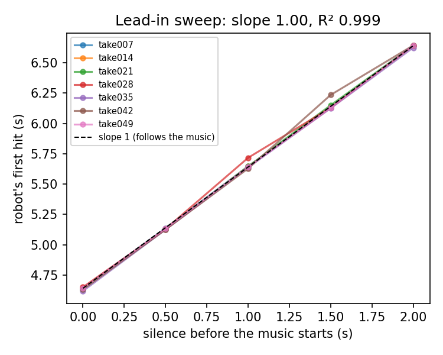
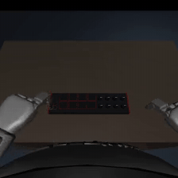

# Results

[Back to the project](../README.md)

`runs/` contains trained weights, training curves, evaluations and videos. Model files are excluded from git because of their size; see the [download instructions](../README.md#replicate-it).

| Folder | Contents |
|---|---|
| `three_part/` | Model trained on claps, rims and shakers |
| `rims_only/` | Three-part model fine-tuned on rims alone |
| `rims_student/` | Distilled 1.8M-parameter rims policy |
| `jaco_v1/` | Results from the earlier Jaco model |

## Evaluation

The main results use held-out recordings at the trained tempo, 65 BPM. Each take is played five times, with 0, 0.5, 1, 1.5 or 2 seconds of silence before the music. This produces 35 claps runs, 40 rims runs and 30 shakers runs for the G1.

**“Right part” counts runs in which the model played the intended part. Timing and beat coverage in the “when right” column are conditional on that choice being correct.** The five runs per take share the same recording, so they aren't five independent performances. Muted music and tempo changes are tested separately.

Half the test takes use chord loop 6, which is absent from training. [Dataset and splits →](../data/README.md)

To reproduce the evaluations or generate a summary table, see the [evaluation commands](../training/README.md#evaluate).

## Version 1: Jaco

The Jaco model was trained on claps only. Results use seven held-out takes:

| Check | Trained model | Reference |
|---|---|---|
| Beats hit | **99.8%** | Demonstrations: 100% |
| Average timing error | **10.1 ms** | Demonstrations: 14.1 ms |
| Delayed music | First-hit shift slope: **1.00** | 1 = follows the music; 0 = fixed clock |
| Muted music | **0 hits** | The robot waits |
| Unseen tempo: 67 BPM | 100% of beats hit, 55 ms late | Trained at 65 BPM |
| Unseen tempo: 82 BPM | 17% of beats hit | Trained at 65 BPM |

### Does timing follow the music?

Because the robot's state includes a clock, it could learn a fixed first-hit time without listening. Random silence was added during both training and testing to check this.

Adding two seconds of silence delayed the first hit by two seconds on every take. With the audio muted, the model did not play. These results support its use of the audio for timing within this task.

Its lower timing error than the human demonstrations may reflect averaging out variation between strokes. The simulation also ran the Jaco at about six times its real speed, so this is not evidence that the real arms could reproduce the performance.

## Three-part G1 model

Training used 10,000 steps with batch size 16. Best validation loss was 0.0104 on normalised actions, compared with 0.040 for a policy that stands still.

| Part | Right part | When right | Trained chords / chord 6 |
|---|---|---|---|
| Claps | 23 / 35 (66%) | 92% of beats hit, 51 ms average timing error | 13 / 15 · 10 / 20 |
| Rims | **2 / 40 (5%)** | — | 0 / 20 · 2 / 20 |
| Shakers | 24 / 30 (80%) | Volume error 0.27; my fades: 0.02 | 13 / 15 · 11 / 15 |

| Separate check | Result |
|---|---|
| Muted music | Stayed still in 16 / 21 takes |
| 67 BPM | Right part in 11 / 21 takes |
| 82 BPM | Right part in 0 / 21 takes |

On rims, the model played claps in 25 of 40 runs and turned the knob in nine. A linear classifier on MERT features correctly identified the part on every validation take, but the policy struggled to use that information. [Loss analysis and fine-tuning →](../training/README.md#why-rims-needed-more-training)

## Rims-only model

The rims-only model starts from the three-part weights and is fine-tuned for 2,500 steps on the 40 rims training takes, at a learning rate of `1e-4`.

| Check | Three-part | Rims-only |
|---|---|---|
| Right part at 65 BPM | 2 / 40 | **33 / 40** |
| Trained chords / chord 6 | 0 / 20 · 2 / 20 | 18 / 20 · 15 / 20 |
| When right | — | 98% of beats hit, 37 ms average timing error |
| Muted music on rims takes | — | Stayed still in 8 / 8 |
| 67 BPM / 82 BPM | 0 / 8 · 0 / 8 | 7 / 8 · 0 / 8 |

On its 40 training takes, the rims-only model succeeded in 145 of 200 runs (72.5%), below its test score. The eight held-out recordings are a small sample, so 33 / 40 should not be treated as a precise estimate of its general success rate. Most remaining failures touch the knob, behaviour retained from the three-part model.

*The rims-only model playing a held-out test take in closed loop, through the same 224 px camera view used as its visual input.*

It also plays rims when given claps music. This model tests learned rims performance, not reliable selection of the missing part. The repo uses it for rims and the three-part model for claps and shakers; selection between models is manual.

## Distilled rims student

| Check | Teacher: rims-only, 7B | Student: 1.8M |
|---|---|---|
| Right part at 65 BPM | 33 / 40 | **40 / 40** |
| When right | 98% of beats hit, 37 ms | 99.7% of beats hit, 34 ms |
| 67 BPM / 82 BPM | 7 / 8 · 0 / 8 | 8 / 8 · 0 / 8 |
| Muted music | Stayed still in 8 / 8 | Stayed still in 8 / 8 |

The teacher initially succeeded in 45 of 64 training runs. In the last DAgger round, with the student doing about 88% of the playing, 61 of 64 runs succeeded (95%).

Only successful teacher runs were used for the first training round; later rounds kept all corrections. This may explain some of the improvement by excluding the teacher's knob-contact failures, but an unfiltered student wasn't trained for comparison. [Distillation procedure →](../training/README.md#distil)

## What these results cover

The experiments use one song, trained only at 65 BPM, in simulation. They test held-out performances, chord changes, delayed starts, muted music and two unseen tempos. They do not establish performance on other songs or a physical robot. Part selection remains unreliable, shaker fades are less precise than the demonstrations, and every model fails at 82 BPM.

